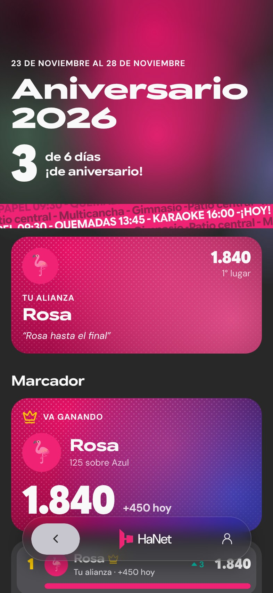

El módulo Aniversario lleva la semana de alianzas a la app: cada estudiante ve su alianza, el marcador en vivo, lo que viene hoy y los plazos, y le llegan las pruebas flash al instante.

**Quién lo organiza:** el CEE y la administración, desde [Organizar](../organizar/) o el botón "Organizar" dentro del Aniversario. Todo el liceo lo ve.

## Armar el aniversario

1. En **"Alianzas y fechas"**, pon las fechas del aniversario y **arma las alianzas** (al menos dos) con cursos completos. Cada estudiante ve la suya según su curso. Cada alianza lleva:
   - uno o dos colores,
   - hasta tres mascotas,
   - su lema y su grito de barra,
   - su Instagram, sus artistas y lo que salió en el sorteo.
2. **Carga las actividades.** "Cargar actividades típicas" trae una lista con nombres y puntajes comunes, que puedes editar o borrar. También puedes crear las tuyas.
3. **Nombra a los jefes de alianza**, que reciben las pruebas flash de su alianza.

## Actividades y puntos

Cada actividad suma puntos de una de dos formas:

| Tipo | Cómo se suma |
| --- | --- |
| **Por lugares** | Defines los puntos de cada lugar (1°, 2°, 3°…). Al poner el resultado, los puntos se suman solos. |
| **Con puntos a mano** | Escribes los puntos de cada alianza. |

Además puedes **sumar o descontar puntos** en cualquier momento, siempre con un motivo. Hay descuentos típicos de las bases a un toque, y la alianza solidaria trae su calculadora de canastas y bonus.

El marcador es la suma de todos los movimientos: nadie escribe un total a mano, y cada estudiante ve el registro completo de puntos.

:::caution[Los motivos nunca nombran personas]
Un descuento dice qué pasó, no quién lo hizo. Las sanciones a estudiantes van por convivencia escolar, no por la app.
:::

## Plazos

Crea plazos para lo que las alianzas deben entregar o inscribir antes de una fecha. A los estudiantes les llega un aviso **24 horas y 2 horas antes**.

## Pruebas flash

1. Escribe qué hay que hacer (por ejemplo: "La primera alianza que llegue a la sala del CEE con un paraguas amarillo gana").
2. Elige a quién le llega: **los jefes de alianza** o **toda la alianza**.
3. Toca **Lanzar**. Llega al instante como notificación.
4. Después marcas el orden en que la cumplieron.

## Avisos

Los avisos del aniversario son publicaciones del [Feed](../feed/) con el tag **#Aniversario**. Las de la Comunidad del liceo o del CEE pueden salir con **"Avisar a las alianzas"**, que manda una notificación a los estudiantes de las alianzas. La página del Aniversario muestra los últimos, y la lista completa está en "Avisos".

## La premiación

- Puedes **ocultar el marcador**: solo quienes organizan ven los puntos, y la ganadora se revela en la premiación.
- Al final, la ganadora aparece con confeti y el marcador se comparte como historia.

## Lo que ven los estudiantes

- La primera vez que abren el aniversario, una bienvenida en pantalla completa.
- Durante la semana, el Inicio se viste con los colores de las alianzas y muestra la tarjeta de su alianza.
- La página del Aniversario: lo de hoy, lo que viene, los últimos movimientos y todas las actividades.
- Un fondo de pantalla de su alianza para guardar en el teléfono.
- Los avisos del aniversario se apagan en Configuraciones → Notificaciones.

Las fotos y los videos siguen en el Instagram de cada alianza.
