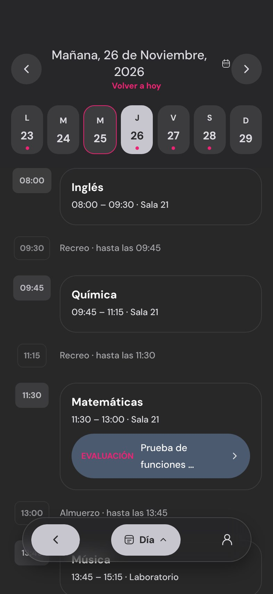

El Calendar es la agenda del curso. Cada día muestra las clases del horario y, dentro de cada clase, sus pruebas y tareas. Tocar una clase abre su Hall en ClassHall.

**Quién lo usa:** todo el curso lo ve. Lo editan la Directiva del curso, el CEE y la administración. Los docentes publican sus evaluaciones y tareas desde [ClassHall](../classhall/), y aparecen aquí solas.

## Vistas

Toca el botón del centro de la barra para cambiar de vista:

| Vista | Qué muestra |
| --- | --- |
| **Día** | Las clases del día con sus evaluaciones y tareas, los recreos y la clase de ahora. |
| **Semana** | Cada día con sus eventos y cuántas clases tiene. En el computador, los días van uno al lado del otro. |
| **Mes** y **Año** | Los días con eventos marcados, para ver lo que viene. |
| **Horario** | La semana tipo del curso. Ver [Horario](../horario/). |

## Tipos de evento

Evaluación sumativa, Evaluación formativa, Taller, Tarea, Entrega (trabajos, informes y proyectos), Remedial, Actividad y Otro.

## Agregar un evento

Desde el menú de la vista, "Crear evento":

1. Elige el **tipo** y escribe un título.
2. Elige **cuándo**: un **bloque del horario** (toma la hora de inicio y término de esa clase y su asignatura) o una **hora exacta**. Parte en el día que tienes seleccionado.
3. Agrega la asignatura, la sala y qué hay que saber o traer.
4. Si quieres, marca **"Solicitar verificación docente"**.

## Plazos de tareas y entregas

Al elegir **Tarea** o **Entrega**, el formulario pide el plazo:

| Plazo | Cuándo vence |
| --- | --- |
| **En una clase** | Al empezar ese bloque del horario. |
| **Hasta una hora** | A la hora que elijas (parte en las 23:59). |

En el día del Calendar, la entrega aparece dentro del bloque de su asignatura con "Se entrega en esta clase" o "Hasta las 23:59". En la semana y en el detalle también se ve "Hasta las HH:MM" en vez de una hora de inicio y fin.

Las tareas que publica un docente en su Hall se manejan en [ClassHall](../classhall/#tareas-y-entregas).

## Lo que confirma un docente

Lo que agenda la Directiva puede no ser oficial. Por eso el docente de la asignatura puede **confirmar, corregir o borrar** lo que publica el curso. Al confirmar una evaluación, pasa a su Hall y lleva un sello de verificado.

## Avisos antes de cada prueba y entrega

Los avisos de pruebas y entregas los programa la app instalada (durante la beta, en Android). El resumen de las 7:00 llega a todos, también en la web.

- **24 y 4 horas antes** de cada evaluación, la app instalada avisa. Se apaga en Configuraciones → Notificaciones, solo en ese teléfono.
- **En la app de iPhone**, dentro de las 24 horas previas aparece una cuenta regresiva en la pantalla bloqueada (Live Activity).
- **Tareas y entregas del Calendar:** la app instalada avisa el día antes a las 19:00 y 3 horas antes (este último solo si cae desde las 9:00). Se apaga en Configuraciones → Notificaciones → "Avisos de entregas", solo en ese teléfono. Las tareas de un Hall no llevan estos avisos, porque ya tienen el recordatorio de las 18:00 para quien no ha entregado.
- **Resumen de las 7:00**, de lunes a viernes, con las clases, pruebas, tareas y entregas del día. Ver [Horario](../horario/).

## El aviso del Inicio

El tile del Calendar en el Inicio muestra lo más próximo del curso. Cada persona elige qué tipos aparecen en Configuraciones → Inicio → "Aviso del Calendar". Por defecto: evaluaciones sumativas y formativas, talleres, tareas, entregas y remediales.

## Widgets

La app instalada trae widgets con la clase de ahora, la siguiente y la próxima prueba. Durante la beta están en Android; los de iPhone llegan con la app en App Store.

- **iPhone:** "HaNet hoy" en la pantalla de inicio y "Calendar" en la pantalla bloqueada.
- **Android:** "HaNet: tu día" en la pantalla de inicio.

## Suscribir el calendario del curso

Cada estudiante puede ver los eventos de su curso en Google Calendar, Calendario de Apple u Outlook. Al abrir cualquier evento del Calendar, "Suscribir mi calendario (iCal)" agrega el calendario del curso (en Android, a Google Calendar) o copia su link. Los eventos cancelados aparecen como "Cancelado".

## Sin internet

El Calendar muestra las pruebas, tareas y eventos como se vieron la última vez, y cada uno se puede abrir.
