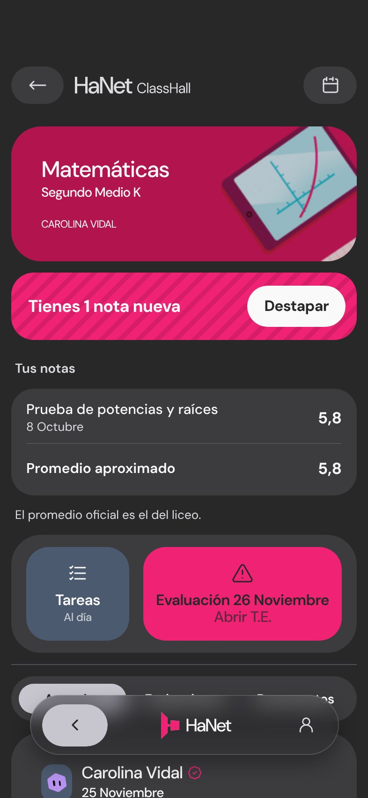

ClassHall reúne las clases del liceo. Cada asignatura de un curso es un **Hall**: ahí el docente publica anuncios, material, evaluaciones y tareas, y los estudiantes entregan.

**Quién lo usa:** los docentes crean y administran sus Halls (la administración también puede). Los estudiantes ven los Halls de su curso y los de sus electivos y dominios.

## Tipos de Hall

| Tipo | Para qué | Quiénes están dentro |
| --- | --- | --- |
| **Plan común** | Formación general. | Todo el curso, sin código. |
| **Electivo** | Formación general electiva de 3° y 4° medio. | Estudiantes de distintos cursos que se unen con un código. |
| **Dominio** | Plan diferenciado, las asignaturas de profundización. | Estudiantes de distintos cursos que se unen con un código. |

En ClassHall, cada estudiante ve dos grupos: **Tu curso** y **Electivos y dominios**, cada clase con su próximo bloque del horario.

## Para docentes

### Crear un Hall

1. En ClassHall, toca **"Crear un Hall"**.
2. Elige la asignatura, el tipo y el curso principal, y una portada.
3. Si es electivo o dominio, comparte el **código de 6 caracteres** con tus estudiantes. Lo encuentras dentro del Hall.

Más tarde puedes cambiar la asignatura o la portada. Tus estudiantes, anuncios y evaluaciones se mantienen.

### Anuncios

Mensajes para toda la clase, con un archivo adjunto si hace falta. Les llega una notificación a tus estudiantes.

### Material

Documentos de la clase: guías, presentaciones, lecturas. Solo los abren quienes están en el Hall.

### Evaluaciones

Cada evaluación lleva fecha, objetivos, habilidades, contenidos y puntajes, y su **tabla de especificaciones (T.E.)**.

- **"Escanear T.E.":** sube la tabla en PDF, Word o una foto y HaNet llena el formulario por ti. Después revisas los datos antes de guardar.
- La evaluación aparece en el **Calendar** del curso (y de cada curso de tus estudiantes, si es un electivo o dominio), con su T.E.
- Si la Directiva ya la había agendado en el Calendar, puedes pasarla a tu Hall: al guardarla queda **verificada** por ti.
- Las notas se ponen dentro de cada evaluación. Ver [Notas](../notas/).

### Tareas y entregas

1. Publica una tarea con **fecha de entrega** y elige si aceptas entregas atrasadas. Aparece en el Calendar como "Tarea".
2. Cada estudiante entrega hasta **6 archivos, fotos o links**, con un comentario.
3. Revisas cada entrega y la marcas como **revisada**, con un comentario. Al estudiante le llega un aviso.

Una entrega la ven solo su autor y el docente. No hay nota en la tarea: las notas van en las evaluaciones.

### Compartir a HaNet

Con la app instalada en el teléfono (durante la beta, en Android), puedes compartir una T.E. o un documento a HaNet desde cualquier app (Archivos, Drive, correo, WhatsApp). Eliges el Hall y HaNet lo recibe.

### En el computador

ClassHall aprovecha la pantalla ancha: tus clases en una grilla con lo que viene en la semana, y la T.E. al lado de los objetivos. Para revisar muchas entregas seguidas, usa el [panel web](../../panel-web/).

## Para estudiantes

- Los Halls de plan común aparecen solos cuando el docente los crea.
- Para un electivo o dominio: **"Unirse a un Hall"** y el código que da el docente.
- Cada Hall muestra los anuncios, el material, las evaluaciones con su T.E. y las tareas por entregar.

## Notificaciones de ClassHall

| Aviso | A quién |
| --- | --- |
| Anuncio, tarea o material nuevo | Estudiantes del Hall. |
| Recordatorio a las 18:00 de una tarea que vence mañana | Estudiantes que todavía no entregan. |
| Entrega revisada | El estudiante que entregó. |

Los docentes no reciben notificaciones de ClassHall. Cada estudiante puede apagarlas en Configuraciones → Notificaciones.
