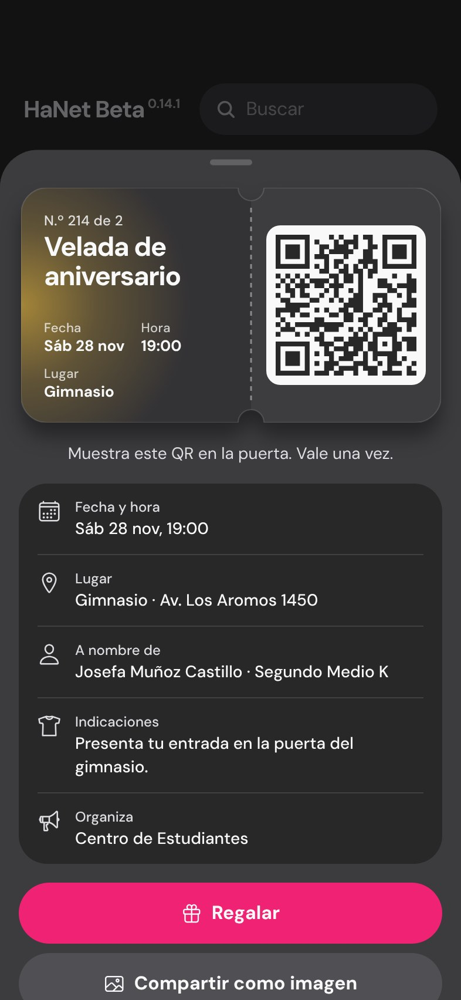

Ofrece y emite entradas para los eventos del liceo, y sigue en vivo quiénes llegaron y quiénes no. Cada entrada tiene un QR que cambia solo, así que una captura de pantalla no sirve en la puerta.

**Quién lo usa:** el CEE y la administración emiten y escanean. Pueden autorizar a docentes para escanear en la puerta. Cada estudiante ve sus entradas en su perfil.

## Crear un evento con entradas

Desde [Organizar](../organizar/), "Crear un evento" → **Privado o formal**:

1. Portada, nombre, fecha, lugar e indicaciones para la entrada (por ejemplo: "Vestimenta formal. Llegar 30 minutos antes").
2. **Estilo de la entrada:** Simple, Con el logo o Formal.
3. Elige si las entradas **se pueden regalar** y si cada persona puede **descargarla para imprimir**.
4. Pon el **cupo** del lugar.

Un evento privado o formal solo lo ven quienes tienen una entrada.

## Emitir las entradas

### Por curso, desde la lista del liceo

1. En el evento, toca **"Emitir por curso"**.
2. Elige los cursos (o todos).
3. Elige **quién las recibe**:
   - **Cada estudiante**, con cuántas entradas por persona.
   - **El Presidente de cada curso**, con cuántas entradas por curso. El Presidente las reparte regalándolas desde su perfil.
4. HaNet muestra cuántas se van a emitir y cuánto cupo queda. Quien ya tiene una entrada de ese evento no recibe otra.
5. Confirma. A cada persona le llega un aviso y la entrada queda en su perfil.

Los Presidentes de curso se nombran en Organizar → Presidentes de curso.

### Una por una

**"Enviar una entrada"** a:

- **Alguien del liceo:** la entrada le llega a su perfil, con un aviso.
- **Un invitado, con link:** escribe su nombre y comparte el link por el medio que prefieras. El invitado abre el link y ahí ve su entrada con el QR, **sin crear una cuenta**. El link sirve una vez y dura hasta el evento.

### La lista

En **"Ver la lista"** está cada entrada con su estado: por llegar, llegó, link sin abrir, regalada, impresa o anulada. Desde ahí puedes reenviar un link, anular una entrada o anularla y enviar otra.

## Lo que hace cada estudiante

- Ve sus entradas en **Perfil → Entradas**. El QR cambia cada 30 segundos y vale una vez.
- **Regala** una entrada con un link que dura 24 horas. Al aceptarla, pasa a la otra cuenta y el QR anterior deja de servir.
- La **comparte como imagen** o la **descarga para imprimir**, con un código para escribir a mano si hace falta. Esa hoja pasa a ser la entrada.
- Cuando la escanean en la puerta, su teléfono lo muestra al instante.

## En la puerta

1. El día del evento, el Inicio de quien organiza muestra **"Hoy organizas"** con el conteo en vivo y el botón **Escanear**. Los docentes autorizados ven "Hoy escaneas".
2. Escanea cada QR. El teléfono suena y vibra: un sonido al leer, otro si la entrada es válida y otro si no sirve o ya se usó.
3. El conteo **"Llegaron X de Y"** se actualiza en vivo.

:::tip
Abre el escáner unos minutos antes de que llegue la gente: el primer escaneo ya responde rápido y el conteo aparece apenas se abre.
:::

### Docentes que escanean

En el evento, **"Docentes que escanean"** permite autorizar a docentes para escanear en la puerta. Lo ven en su Inicio mientras la puerta está abierta.
