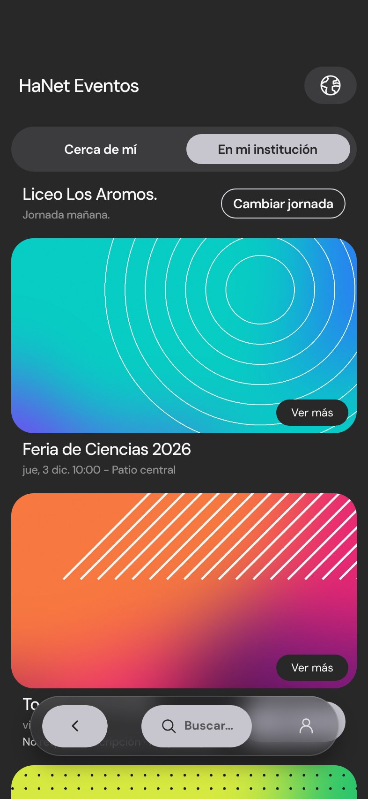
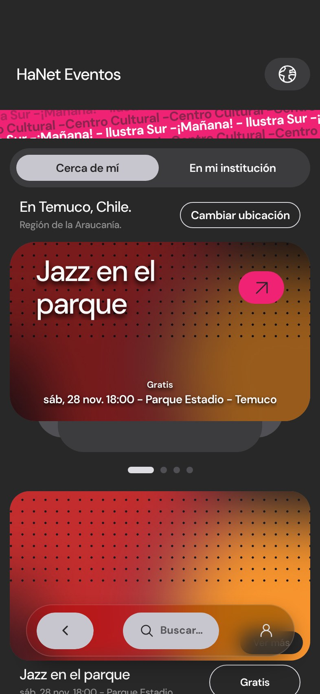

¿Tienes una actividad en el patio, una charla o una feria? Publícala en Eventos y llega a los estudiantes de la jornada que elijas.

Eventos tiene dos pestañas: **En mi institución**, con lo que publica el liceo, y **Cerca de mí**, con panoramas de la ciudad.

**Quién publica:** el CEE y la administración.

## Publicar un evento

Desde [Organizar](../organizar/), "Crear un evento" → **De la institución**:

1. Portada, nombre, fecha y hora de inicio (y de término, si quieres), lugar y descripción.
2. **Jornada:** mañana, tarde o ambas. Cada estudiante elige su jornada en Eventos y ve lo que le corresponde.
3. **Inscripción:**

| Tipo | Qué ve quien organiza |
| --- | --- |
| **Con lista** | El nombre y curso de cada inscrito, y la lista para descargar desde el panel web. |
| **Solo contador** | Cuántos van, sin nombres. |
| **Sin inscripción** | El evento solo informa. |

Puedes poner un **cupo**. Para una gala o una velada con entrada, usa [Entradas](../entradas/).

## Lo que hacen los estudiantes

- Se inscriben o marcan que van.
- **Reaccionan** con emoji.
- **Comparten el evento como historia:** HaNet arma una imagen vertical para Instagram y otras apps.

Quien tiene un Espacio en el [Feed](../feed/) (administración, CEE y Directiva) también puede compartir el evento ahí.

## Pasar lista con HN-QR

Para saber quién llegó, quien organiza escanea el **HN-QR** del perfil de cada estudiante.

1. Abre el evento y toca **"Pasar lista"**. Se abre 3 horas antes del evento y se cierra 24 horas después.
2. Escanea el HN-QR. El teléfono suena y vibra al leer, y avisa si el código no sirve.
3. El conteo **"Llegaron"** se actualiza en vivo.

El HN-QR de cada persona cambia cada 30 segundos y se valida en el servidor, así que una captura de pantalla no sirve. Si alguien saca una captura, la app le avisa.

## Cerca de mí

Panoramas de la ciudad (conciertos, ferias, obras) que carga el equipo de HaNet, para todas las instituciones de la ciudad. Algunos traen un **cupón HaNet** con descuento estudiantil, cuando la ticketera lo ofrece.

Los panoramas se eligen pensando en estudiantes: al cargar uno, HaNet advierte al equipo si parece no apto (una discoteca, un evento para mayores de 18 o con barra libre).

¿Tu liceo quiere sumar un evento abierto a la ciudad? Escríbenos a [muxp@muxp.art](mailto:muxp@muxp.art).
