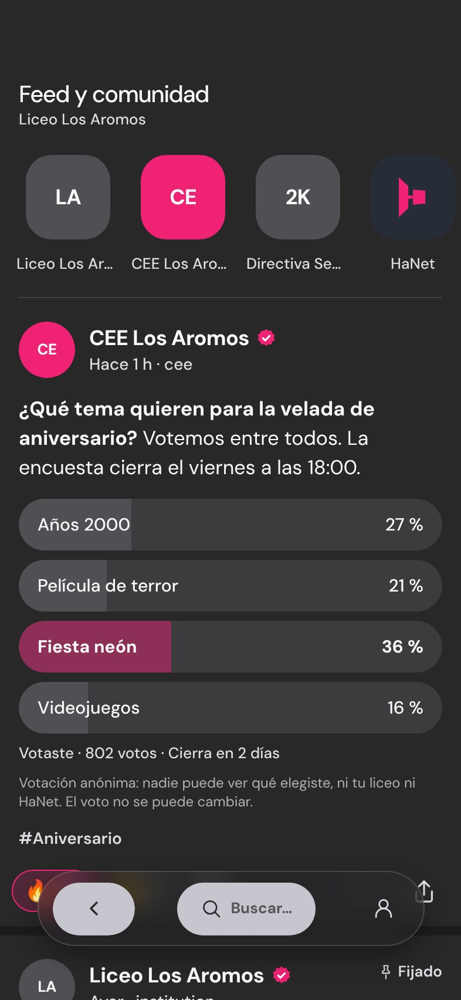

El Feed reúne los comunicados del liceo en un solo lugar, en vez de diarios murales y cadenas de WhatsApp. Publican quienes tienen un rol; los estudiantes leen, reaccionan y votan.

## Espacios

Cada publicación sale a nombre de un **Espacio**, no de una persona:

| Espacio | Quién publica | A quién le llega |
| --- | --- | --- |
| **Comunidad** del liceo | La administración | Todo el liceo, una jornada o algunos cursos. |
| **CEE** del liceo | El Centro de Estudiantes | Todo el liceo. |
| **Directiva** de cada curso | La Directiva de ese curso | Solo su curso. |
| **HaNet** | El equipo de HaNet | Todas las instituciones con Feed. |

La administración ve todas las publicaciones de su liceo.

## Publicar

1. Elige el Espacio y a quién le llega.
2. Escribe el mensaje. Puedes usar negrita, cursiva, listas, citas y links.
3. Agrega hasta **6 imágenes**.
4. Elige hasta **3 tags** (Avisos, Actividades, Aniversario, Becas, Deportes, Pruebas, Salud). Ayudan a encontrar la publicación en el buscador.
5. Si quieres:
   - **Fijar arriba**, para que quede primera.
   - **Enviar como notificación**, para que llegue al teléfono de quienes la ven. Después, en tus Notificaciones queda a cuántas personas les llegó.

También se publica desde [Organizar](../organizar/).

## Lo que hacen los estudiantes

- Leen y buscan publicaciones por tag o texto.
- **Reaccionan** con un emoji de una lista fija: 👍 ❤️ 😂 🎉 😮 🔥 👏.
- **Reportan** una publicación si algo no corresponde.

No hay comentarios ni publicaciones de estudiantes.

## Votaciones

Una publicación puede llevar una votación. Es un módulo aparte, que necesita el Feed activo.

**Quién crea votaciones:** la administración (en la Comunidad del liceo) y el CEE (en su Espacio).

1. Escribe la pregunta y las opciones.
2. Elige cuánto dura: 1 día, 3 días, 1 semana o 2 semanas.
3. Elige cuándo se ven los resultados: **al votar** o **al cerrar**.

Una votación no se puede cambiar una vez publicada.

### Siempre anónimas

Nadie puede ver qué votó cada persona: ni el liceo ni HaNet. Cada cuenta vota una vez y no puede cambiar su voto. HaNet solo guarda que esa cuenta ya votó y suma uno a la opción elegida, sin unir una cosa con la otra.

## Notificaciones del Feed

Las publicaciones enviadas como notificación quedan siempre en la sección [Notificaciones](../notificaciones/). Cada persona puede apagar el aviso en el teléfono en Configuraciones → Notificaciones.
