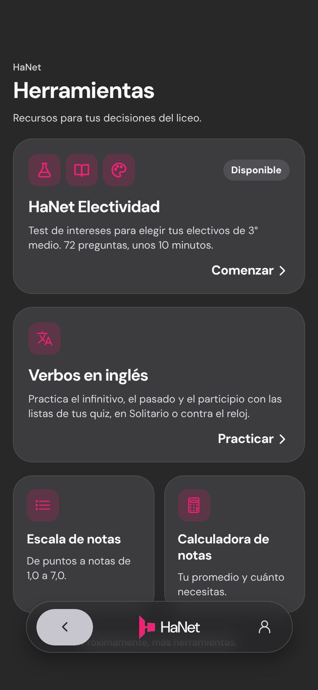

Herramientas reúne recursos para las decisiones y el estudio de cada estudiante. Se abre desde el tile Herramientas del Inicio o desde el buscador.

| Herramienta | Disponible |
| --- | --- |
| HaNet Electividad | Si el liceo activa el módulo. |
| Escala de notas | Siempre. |
| Calculadora de notas | Siempre. |
| Verbos en inglés | Siempre. |

## HaNet Electividad

Un test de intereses para que cada estudiante de **2° medio** elija sus electivos de 3° medio con más información.

- **72 preguntas** del tipo "¿qué prefieres?", entre dos actividades, sobre **9 áreas** de interés. Cada par aparece dos veces, para medir la consistencia. Toma unos 10 minutos.
- Se puede **pausar** y seguir después: las respuestas quedan en el teléfono hasta terminar.
- Al terminar, el estudiante ve sus **tres áreas de mayor interés** con una animación, y después el detalle: todas las áreas, carreras relacionadas y sus comparaciones más claras.
- Se puede **repetir**. El intento nuevo pasa a ser el resultado y los anteriores quedan guardados, con la diferencia por área.

**Quién ve el resultado:** el estudiante y la administración de su liceo. Si hace falta, la administración puede borrar los resultados de un estudiante para que empiece de cero.

:::note
La postulación a electivos con la oferta del liceo y la base completa de carreras llegan después de la beta.
:::

## Escala de notas

Escribe el **puntaje máximo** y la **exigencia**, y HaNet muestra la tabla de puntos a notas de 1,0 a 7,0, cuántos puntos se necesitan para el 4,0 y la nota de cualquier puntaje. Usa la escala chilena, con redondeo a un decimal.

## Calculadora de notas

Calcula el promedio de una asignatura, con o sin porcentajes, y cuánto se necesita en lo que falta para llegar a la nota que se quiere. Con el módulo [Notas](../notas/), una nota destapada se agrega a la calculadora con un toque.

La escala y la calculadora funcionan **solo en el teléfono**: lo que se escribe ahí no sale de él. El promedio oficial es el del liceo.

## Verbos en inglés

Un quiz para practicar casi 300 verbos regulares e irregulares, con su significado en español.

- **Listas:** las de los quiz del liceo, 20 verbos al azar, solo regulares, solo irregulares o una lista propia.
- **Solitario:** en **Desafío**, un verbo a la vez; en **Repaso**, todos a la vista para estudiar. Al final, el puntaje, el tiempo y las correcciones, con "Repetir los que fallé".
- **Infinito:** contra el reloj. Cada acierto suma segundos, cada error resta y cada vuelta va más rápido.
- Sonidos y música que se apagan aparte y respetan el modo silencio.

Las mejores marcas quedan guardadas en el teléfono. No hay rankings ni duelos entre estudiantes.
