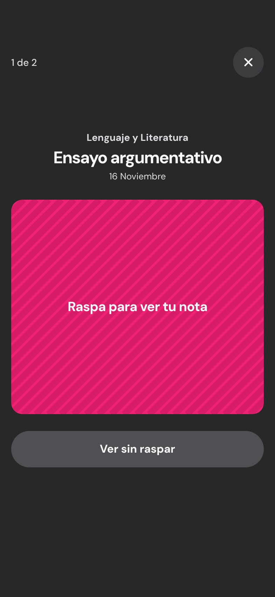
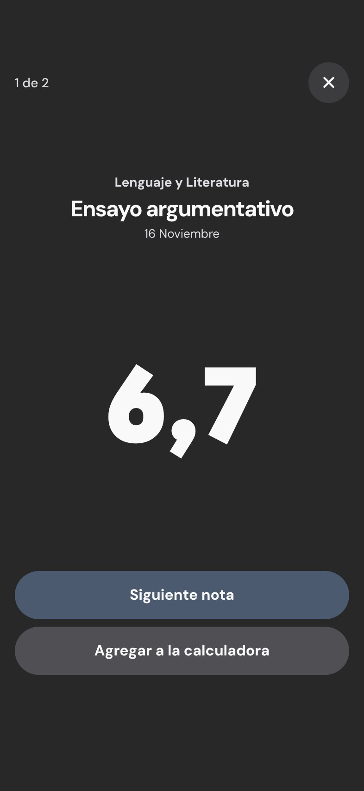

Con Notas, cada evaluación de ClassHall puede llevar las notas del curso. El estudiante recibe un aviso que **nunca muestra la nota** y la destapa en pantalla completa, raspándola con el dedo.

**Quién lo usa:** el docente del Hall y la administración ponen y publican notas. Cada estudiante ve solo las suyas.

## Para docentes

### Poner las notas

1. Abre la evaluación en tu Hall y entra a la sección **Notas**.
2. Escribe la nota de cada estudiante, de 1,0 a 7,0 con un decimal. Para ir rápido, escribe "62" y queda 6,2.
3. Las notas quedan como **borrador**: nadie más las ve.
4. Cuando estén listas, toca **Publicar**. A cada estudiante le llega su aviso.

En el [panel web](../../panel-web/) también puedes pegar las notas de todo el curso desde una planilla.

### Corregir una nota

Después de publicar, lo que cambias se publica al guardar y al estudiante le llega un aviso de nota **corregida**.

### Ponderación

Cada evaluación puede llevar una ponderación opcional, que se usa en el promedio aproximado del estudiante.

## Para estudiantes

- **El aviso nunca muestra la nota**, tampoco en la pantalla bloqueada.
- La nota se destapa en pantalla completa: se raspa con el dedo o se toca "Ver sin raspar".
- Mientras está tapada, todas las notas se ven iguales.
- Después queda en **Notas**, dentro de ClassHall, con todas sus asignaturas y el **promedio aproximado** del 1er semestre, del 2° semestre o del año.
- Desde una nota se puede pasar a la [Calculadora de notas](../herramientas/#calculadora-de-notas).

### Proteger Notas

Opcional, en Configuraciones → Privacidad. Con él, HaNet pide Face ID, huella o el código del teléfono para abrir las notas, y las vuelve a bloquear cuando la app pasa a segundo plano. Vale solo en ese teléfono.

## Lo que conviene saber

- **El promedio oficial es el del liceo.** El que ve el estudiante es aproximado: los semestres se cuentan por la fecha de la evaluación (enero a julio el 1°, agosto a diciembre el 2°) y el anual promedia los dos.
- Las notas conceptuales no entran al promedio.
- Notas no reemplaza el libro de clases. El libro de clases digital (Notebook) llega después de la beta.
- Quién ve una nota: el estudiante, su docente y la administración de su liceo.
