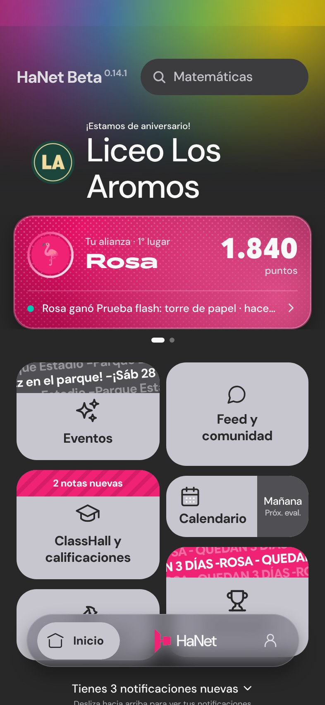

HaNet es la app de tu liceo. Reúne en un solo lugar lo que hoy vive repartido entre grupos de WhatsApp, diarios murales, correos y planillas: las evaluaciones de cada curso, las clases, las notas, los eventos, las entradas y las actividades del liceo.

Funciona en el navegador de cualquier teléfono o computador, y como app en Android. Tiene además un **panel web** para el trabajo de escritorio: listas largas, cargas masivas y revisiones en lote. Ver [Dónde se usa HaNet](../primeros-pasos/#dónde-se-usa-hanet).

## Qué ve un estudiante

- **Su semana:** el horario de su curso y de sus electivos, con las pruebas y tareas dentro de cada clase.
- **Avisos a tiempo:** un resumen a las 7:00 con las clases y pruebas del día, y recordatorios 24 y 4 horas antes de cada evaluación.
- **Sus clases:** anuncios, material, tareas y evaluaciones de cada asignatura en ClassHall.
- **Sus notas:** cada nota llega tapada y se destapa en pantalla completa.
- **La vida del liceo:** eventos, entradas, alianzas del aniversario y comunicados.

## Qué hace el liceo

- **Docentes:** publican en sus clases, revisan entregas y ponen notas desde la app o el panel web.
- **Administración:** organiza eventos y entradas, publica comunicados, suspende clases o adelanta la salida y ve los resultados de su institución.
- **Directiva de cada curso:** mantiene al día el Calendar y el horario de su curso.
- **Centro de Estudiantes:** organiza eventos, votaciones y el aniversario.

## Cómo está armado

HaNet es una **base** que todo liceo tiene (Calendar, Horario, ClassHall, Eventos del liceo y Notificaciones) más **módulos** que tu liceo activa solo si los necesita: Notas, Entradas, Feed, Votaciones, Aniversario y HaNet Electividad. Revisa el detalle en [Módulos](../modulos/).

## Lo que HaNet no hace

- **No tiene funciones sociales entre estudiantes.** Nada de chats, seguidores ni publicaciones de estudiantes. Los estudiantes leen, se inscriben, reaccionan y votan; publican quienes tienen un rol en el liceo.
- **No reemplaza el libro de clases.** El promedio oficial sigue siendo el del liceo. El libro de clases digital (Notebook) llega después de la beta.
- **No se conecta con otros sistemas.** HaNet no lee datos de SchoolNet ni de otras plataformas.

## Etapa actual

HaNet está en **beta**, con un liceo piloto: el Liceo Camilo Henríquez de Temuco. Cada versión nueva llega a la app con un resumen de lo que cambió.

Para empezar, sigue los [primeros pasos](../primeros-pasos/).
